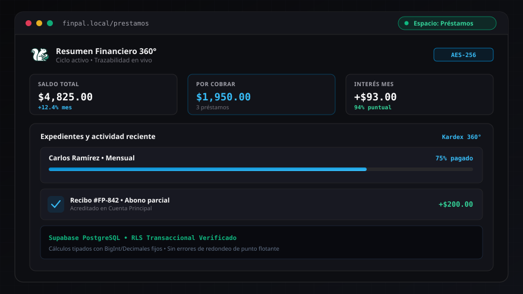
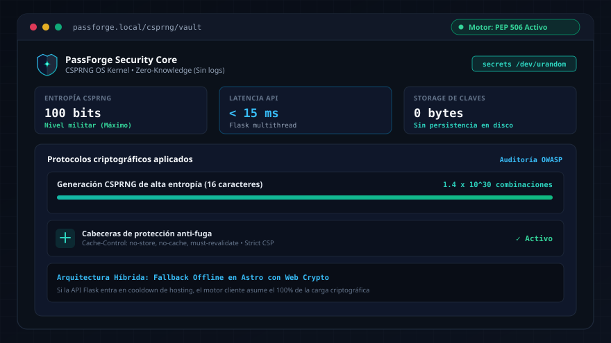
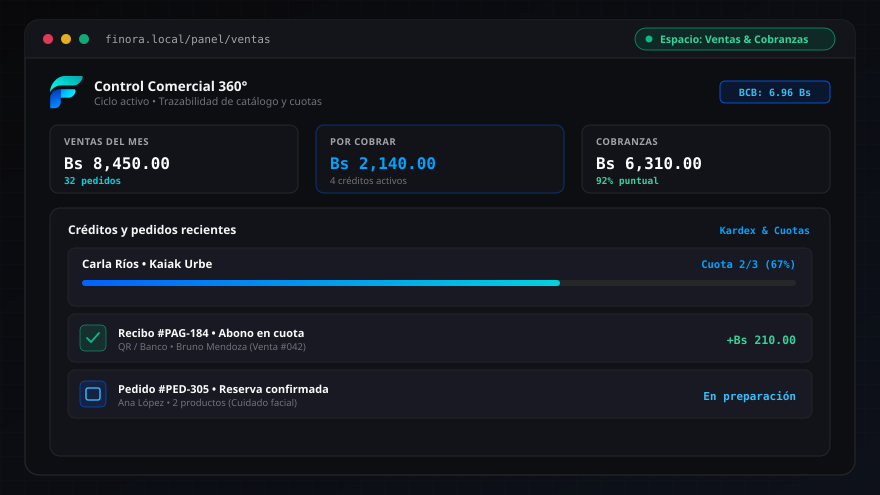
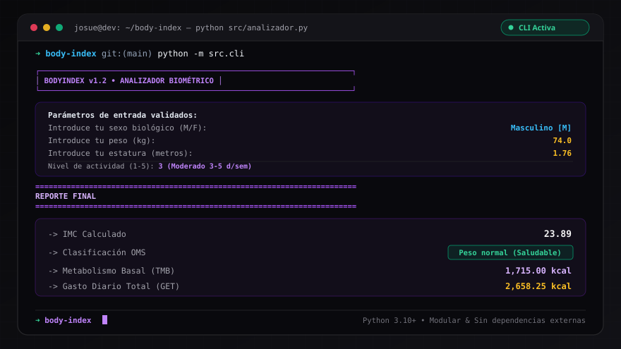

  

  <strong>Josué Chacae</strong> &bull; <code>UAGRM &bull; 7.º Semestre (70%)</code> &bull; <code>Bolivia</code>

  <em>Backend Seguro &bull; Ciberseguridad Aplicada &bull; Arquitectura de Sistemas</em>

  
  
  
  

  Estudiante de Ingeniería en Sistemas en la UAGRM enfocado en <strong>ciberseguridad</strong>, <strong>desarrollo backend</strong> e <strong>infraestructura TI</strong>. 
  En formación académica activa; abierto a consultas sobre <strong>pasantías</strong>, <strong>prácticas</strong> y <strong>proyectos de software</strong>.

---

## Proyectos destacados

<table width="100%">
<tr>
<td width="500" valign="top">
  
    
  <strong><a href="https://github.com/chacaejosue/finpal">FinPal</a></strong> 
  Control de finanzas personales y préstamos con simulador francés, PostgreSQL RLS y cifrado en servidor.
</td>
<td width="500" valign="top">
  
    
  <strong><a href="https://github.com/chacaejosue/pass-forge">PassForge</a></strong> 
  Generador seguro de contraseñas basado en <code>secrets</code> (CSPRNG), con Flask API y cliente en Astro.
</td>
</tr>
<tr>
<td valign="top">
  <code>Next.js 16</code> &bull; <code>TypeScript</code> &bull; <code>Supabase</code> &bull; <code>PostgreSQL</code> 
  <a href="https://github.com/chacaejosue/finpal">Ver repositorio &rarr;</a>
</td>
<td valign="top">
  <code>Python 3</code> &bull; <code>Flask API</code> &bull; <code>Astro</code> &bull; <code>CSPRNG</code> 
  <a href="https://passforge.vercel.app/">Probar demo en vivo &rarr;</a>
</td>
</tr>
<tr>
<td width="500" valign="top">
  
    
  <strong><a href="https://github.com/chacaejosue/finora">Finora</a></strong> 
  Sistema de venta directa por catálogo con inventario kardex, cobranzas en cuotas y reportería comercial.
</td>
<td width="500" valign="top">
  
    
  <strong><a href="https://github.com/chacaejosue/body-index">BodyIndex</a></strong> 
  Suite de análisis biométrico que integra ecuaciones científicas para cálculo de IMC, TMB y macronutrientes.
</td>
</tr>
<tr>
<td valign="top">
  <code>Laravel MVC</code> &bull; <code>PHP 8</code> &bull; <code>MySQL</code> &bull; <code>Scrum</code> 
  <a href="https://github.com/chacaejosue/finora">Ver repositorio &rarr;</a>
</td>
<td valign="top">
  <code>Python 3</code> &bull; <code>FastAPI</code> &bull; <code>Next.js</code> &bull; <code>CLI</code> 
  <a href="https://github.com/chacaejosue/body-index">Ver repositorio &rarr;</a>
</td>
</tr>
</table>

  <a href="https://josuechacae.dev">
    <strong>Explorar todos los proyectos en josuechacae.dev &rarr;</strong>
  </a>

---

## Stack tecnológico

<table width="100%">
<tr>
<td width="500" valign="top">
  <strong>Lenguajes</strong>  
  <code>Python 3</code> &bull; <code>TypeScript</code> &bull; <code>JavaScript</code> 
  <code>PHP 8</code> &bull; <code>Java</code> &bull; <code>SQL</code>
</td>
<td width="500" valign="top">
  <strong>Backend & Web</strong>  
  <code>Next.js 15</code> &bull; <code>Flask REST API</code> &bull; <code>Laravel MVC</code> 
  <code>Astro</code> &bull; <code>Tailwind CSS</code>
</td>
</tr>
<tr>
<td width="500" valign="top">
  <strong>Bases de Datos</strong>  
  <code>PostgreSQL</code> &bull; <code>Supabase</code> &bull; <code>MySQL</code> 
  <code>SQL Server</code> &bull; <code>Modelado UML</code>
</td>
<td width="500" valign="top">
  <strong>Seguridad & Herramientas</strong>  
  <code>CSPRNG & Criptografía</code> &bull; <code>Linux CLI</code> 
  <code>Git / GitHub</code> &bull; <code>Redes TCP/IP</code> &bull; <code>Scrum</code>
</td>
</tr>
</table>

  <strong>Competencia idiomática:</strong> Español (Nativo) &bull; Inglés (EF SET Certificado B1 — Lectura Técnica C1 Advanced)

---

## Actividad en GitHub

  <picture>
    <source media="(prefers-color-scheme: dark)" srcset="./profile/github-snake-dark.svg">
    <source media="(prefers-color-scheme: light)" srcset="./profile/github-snake.svg">
    
  </picture>

---

## Certificaciones

<table>
<tr>
<td width="50%" valign="top">
  <strong><a href="https://www.coursera.org/account/accomplishments/professional-cert/certificate/X400VUDVHB51">Google Cybersecurity Certificate</a></strong> 
  <code>Google</code> &bull; <code>2026</code> &bull; <a href="https://www.coursera.org/account/accomplishments/professional-cert/certificate/X400VUDVHB51">Verificar credencial &rarr;</a>  
  Seguridad en redes, Linux CLI, scripts en Python para análisis de tráfico, SIEM y gestión de vulnerabilidades.
</td>
<td width="50%" valign="top">
  <strong><a href="https://www.coursera.org/account/accomplishments/professional-cert/certificate/OYXOQLK4VQ7X">Microsoft Python Development</a></strong> 
  <code>Microsoft</code> &bull; <code>2026</code> &bull; <a href="https://www.coursera.org/account/accomplishments/professional-cert/certificate/OYXOQLK4VQ7X">Verificar credencial &rarr;</a>  
  Fundamentos y estructuras avanzadas en Python, desarrollo de APIs, buenas prácticas de ingeniería y testing.
</td>
</tr>
<tr>
<td width="50%" valign="top">
  <strong><a href="https://cert.efset.org/en/uQqx1M">EF SET English Certificate</a></strong> 
  <code>EF SET</code> &bull; <code>2026</code> &bull; <a href="https://cert.efset.org/en/uQqx1M">Verificar credencial &rarr;</a>  
  Certificación CEFR B1 — Competencia C1 Advanced en lectura y comprensión de documentación técnica.
</td>
<td width="50%" valign="top">
  <strong><a href="https://www.coursera.org/account/accomplishments/professional-cert/certificate/1XAJ7P5ST4YR">Google Digital Marketing & E-commerce</a></strong> 
  <code>Google</code> &bull; <code>2026</code> &bull; <a href="https://www.coursera.org/account/accomplishments/professional-cert/certificate/1XAJ7P5ST4YR">Verificar credencial &rarr;</a>  
  Estrategias de analítica web, modelos comerciales y optimización de conversión.
</td>
</tr>
</table>

---

## Contacto

  Actualmente en formación académica. Abierto a consultas sobre pasantías, prácticas y proyectos:  
  <a href="https://josuechacae.dev/#contacto">
    <strong>Canal de contacto y correo seguro en josuechacae.dev &rarr;</strong>
  </a>
    
  <a href="https://www.linkedin.com/in/chacae-josue">LinkedIn</a> &bull;
  <a href="https://josuechacae.dev">Portafolio</a> &bull;
  <a href="https://josuechacae.dev/cv-josue-chacae.pdf">Descargar CV (PDF)</a>

